<p align="center">
  
</p>

<h1 align="center">荒野中枢 · Hunger Desolate</h1>

<p align="center">
  通过 SSH/SFTP 管理 Linux 上的《饥荒联机版》独立专服<br />
  Windows / macOS 桌面控制台 · Tauri 2 · Vue 3 · Rust
</p>

<p align="center">
  
  
  <a href="https://v2.tauri.app/"></a>
  <a href="https://vuejs.org/"></a>
  <a href="https://www.rust-lang.org/"></a>
  <a href="LICENSE"></a>
</p>

> 当前版本 **1.3.8**（正式版） · 远端固定 Linux amd64 + Docker Compose 路线 · 安装包尚未签名

[简介](#简介) · [功能](#功能) · [界面展示](#界面展示) · [技术栈](#技术栈) · [快速开始](#快速开始) · [构建与打包](#构建与打包)

## 简介

**荒野中枢**把《饥荒联机版》独立专服的部署、配置、MOD、备份和更新收进一个桌面应用。你只需要一台 Linux 主机和 SSH 凭据，其余操作在本地完成；远端始终使用 Docker Compose。

同一服务器可以运行多个相互隔离的专服：每个专服有自己的 Compose 项目、网络、目录、端口和存档。桌面端为查询、写入、任务和草稿绑定完整 target，避免多主机、多实例之间的串扰。

## 功能

| 模块 | 能力 |
| --- | --- |
| 主机连接 | SSH 指纹扫描与确认、密码/私钥认证、系统凭据库、hostId 发现 |
| 环境与 Docker | 系统、Docker/Compose、资源和目录权限检查；安装 Docker/Compose |
| Release 与镜像 | DST runtime 镜像构建、导入、验证、删除；构建缓存与磁盘清理 |
| 专服 | 创建、启停、重启、删除；概览、运行摘要、分片日志、诊断 |
| 世界配置 | Master/Caves 分片、世界规则、生成参数、Token/密码保存与应用 |
| MOD | 主机库 Workshop/合集导入、检查更新、批量更新；专服启用、配置、应用；UGC 预置 |
| 备份与恢复 | 创建、下载、恢复、保护点；导入校验；备份备注 |
| DST 更新 | 检查最新 build；按实例切换版本；保护点与失败回滚 |
| 任务与体验 | 全局任务抽屉、跨页面继续、主题、键盘与焦点支持 |

## 界面展示

| 主机列表 | 专服列表 |
| --- | --- |
| 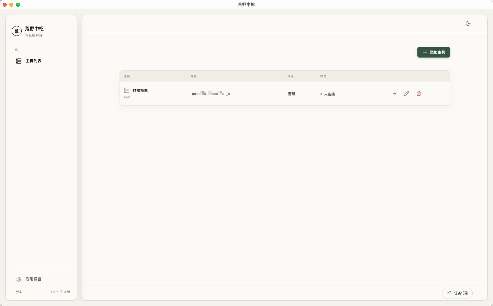 | 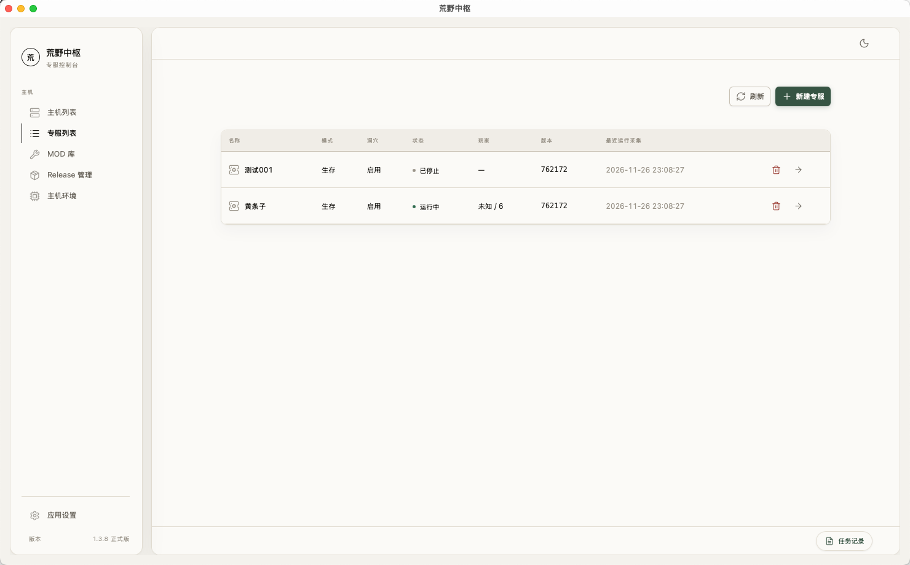 |

| MOD 库 | Release 管理 |
| --- | --- |
| 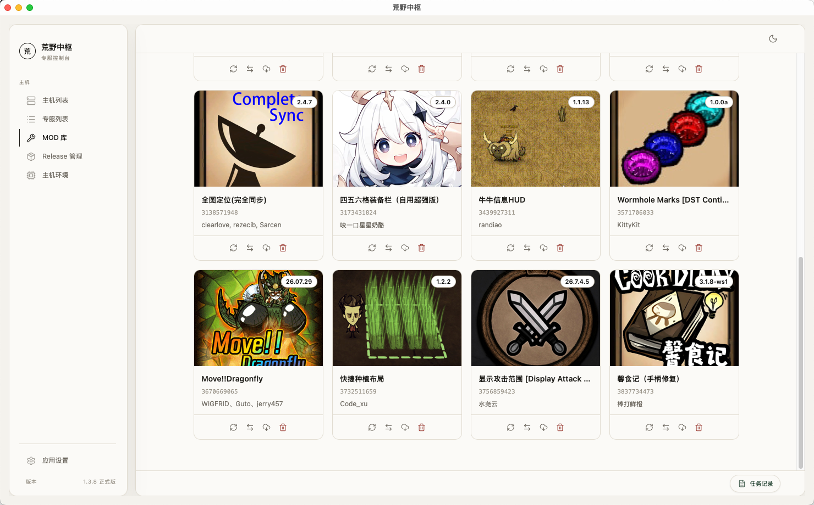 | 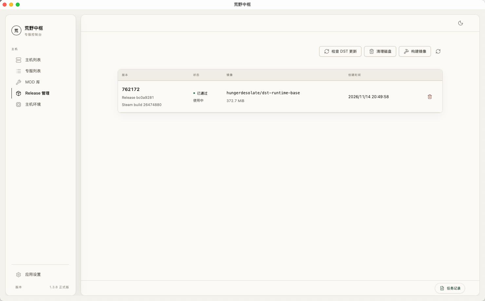 |

| 主机环境                                           | 专服-概览                                                    |
| -------------------------------------------------- | ------------------------------------------------------------ |
| 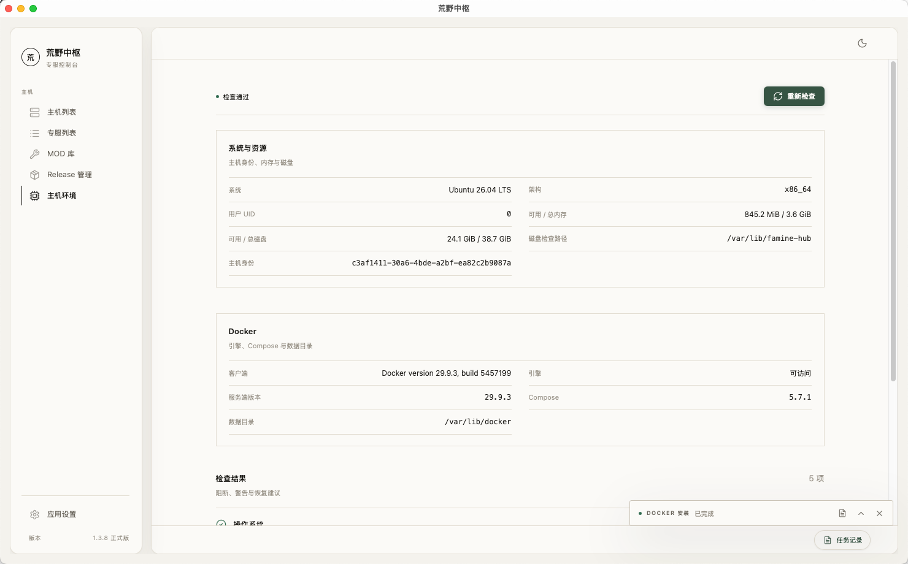 | 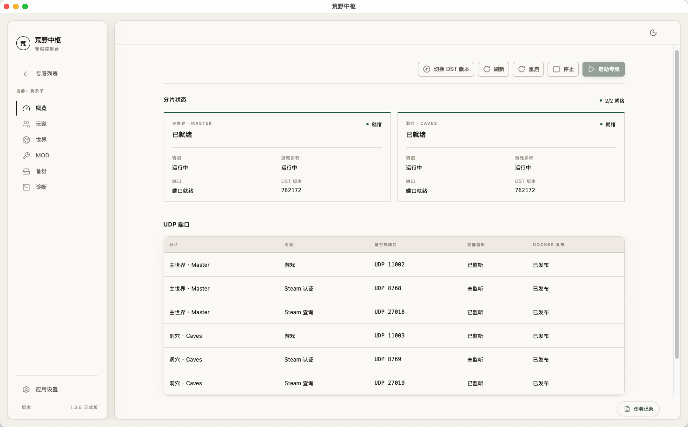 |

| 专服-世界                                                    | 专服-MOD                                                     |
| ------------------------------------------------------------ | ------------------------------------------------------------ |
| 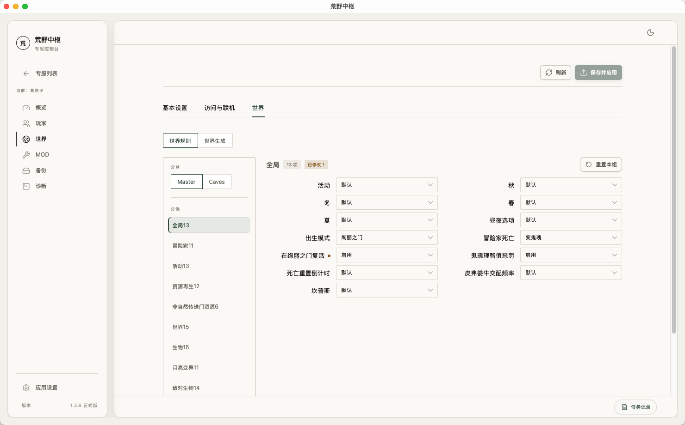 | 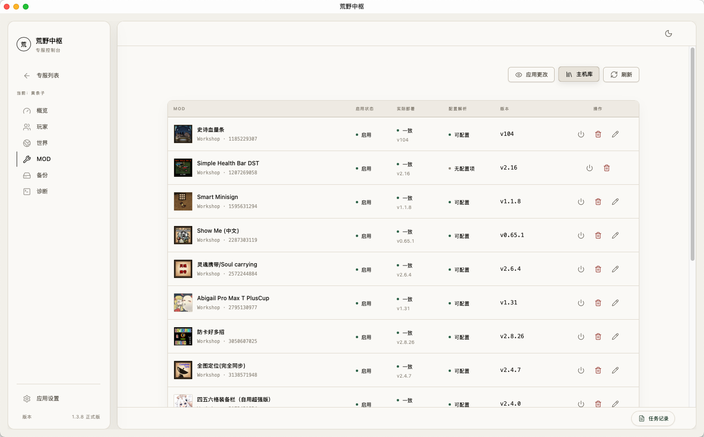 |

| 专服-备份                                                    | 专服-诊断                                                    |
| ------------------------------------------------------------ | ------------------------------------------------------------ |
| 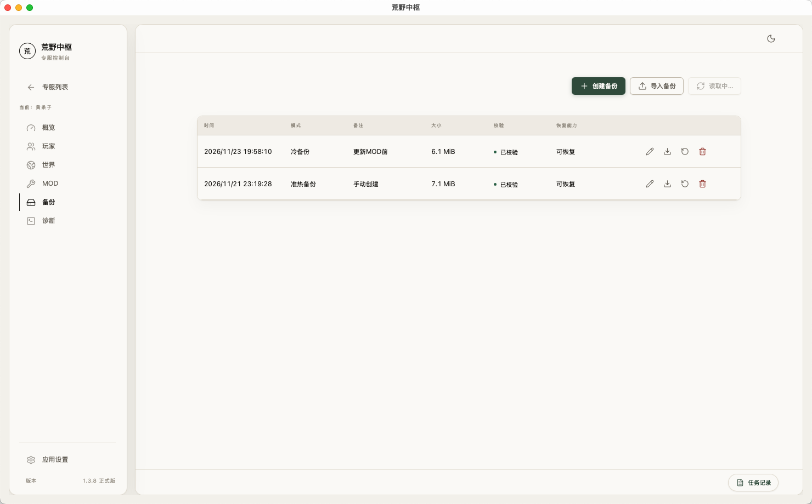 | 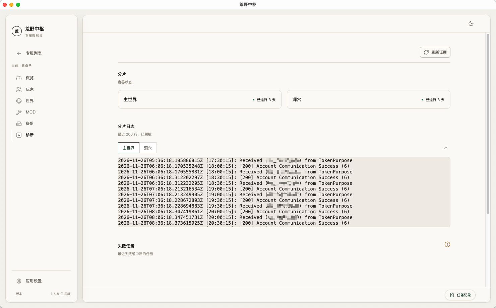 |


## 技术栈

| 层 | 技术 |
| --- | --- |
| 桌面壳 | Tauri 2 |
| 前端 | Vue 3.5、TypeScript、Naive UI、Vite 6 |
| 状态与路由 | Vue Router 4、Composable |
| 后端 | Rust、rusqlite、ssh2、mlua、rustls |
| 远端 | Linux amd64、Docker Compose、DST dedicated server |
| 质量 | vue-tsc、Node test、cargo fmt/check/test/clippy |

## 架构

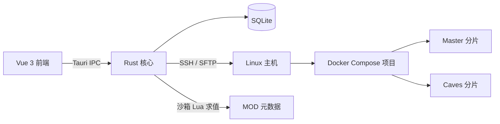

- 本地 SQLite 只保存连接元数据、任务和迁移记录；凭据由系统凭据库管理。
- 每个专服对应一个独立的 Compose 项目，Master/Caves 分片以独立容器运行。
- 远端脚本通过 SSH 上传执行，由主机 controller 守护任务生命周期。

## 快速开始

### 环境要求

| 依赖 | 要求 |
| --- | --- |
| Node.js | 22.18+（npm 10+） |
| Rust | stable，对应平台的 Tauri 2 构建环境 |
| macOS | Xcode Command Line Tools |
| Windows | MSVC Build Tools、WebView2 |
| 远端主机 | Linux amd64，Docker 与 Docker Compose |

### 桌面模式

克隆本仓库后进入项目目录：

```bash
cd HungerDesolate
npm ci
npm run desktop:dev
```

桌面模式使用应用标识 `app.hungerdesolate.hub`，本地数据库为 `hunger-desolate.sqlite3`。

### 浏览器预览

```bash
npm run dev
```

打开 `http://127.0.0.1:1421`。浏览器模式只用于界面预览，不连接真实后端。

## 构建与打包

```bash
npm run check
npm run desktop:build
```

| 平台 | 典型产物 | 目录 |
| --- | --- | --- |
| macOS | `.dmg`、`.app` | `src-tauri/target/release/bundle/dmg/`、`.../macos/` |
| Windows | `.exe`（NSIS）、`.msi` | `src-tauri\target\release\bundle\nsis\`、`...\msi\` |

仅编译桌面程序、不生成安装包：

```bash
npm run tauri -- build --debug --no-bundle
```

<details>
<summary>Windows 构建说明</summary>

在 Windows 上安装 Node.js 22.18+、Rust stable（MSVC）、Visual Studio Build Tools、WebView2 和 Strawberry Perl。`ssh2` 使用 `vendored-openssl`，构建 OpenSSL 需要 Perl。

```powershell
npm ci
npm run version:sync
npm run tauri -- build --bundles nsis
```

产物位于 `src-tauri\target\release\bundle\nsis\*-setup.exe`。

> macOS 交叉编译 Windows 不在本项目的支持范围：OpenSSL 的 MSVC 构建依赖 `nmake`；改用 libssh2 的 WinCNG 会关闭 ed25519 支持。

</details>

## 项目结构

```text
.
├── LICENSE                  # MIT
├── THIRD_PARTY_NOTICES.md   # 第三方许可
├── src/                     # Vue 3 前端
│   ├── pages/               # 主机、专服、环境、Release、世界、MOD、备份、诊断、设置
│   ├── components/          # 通用组件、任务面板、对话框
│   ├── api/                 # Tauri command 调用
│   ├── composables/         # 工作区、任务、操作、设置和弹窗状态
│   ├── lib/                 # 请求隔离、任务合并、配置解析、持久化规则
│   └── naive/               # Naive UI 主题映射与覆盖
├── src-tauri/               # Rust 桌面后端
│   ├── src/                 # command、DTO、SQLite、SSH、任务与远端脚本编排
│   ├── migrations/          # 追加式数据库迁移
│   └── tests/               # Registry/Manifest fixture
├── remote-scripts/          # 远端探测、动作与玩家桥接脚本
├── docker/runtime/          # DST 运行时镜像与构建脚本
├── docs/                    # 诊断、MOD 库、备份边界与 Release 指南
│   └── screenshots/         # README 界面截图
└── scripts/                 # 测试与构建辅助脚本
```

## 开发约定

提交前至少运行：

```bash
npm run check
cargo fmt --manifest-path src-tauri/Cargo.toml -- --check
cargo check --manifest-path src-tauri/Cargo.toml --all-targets
cargo test --manifest-path src-tauri/Cargo.toml
cargo clippy --manifest-path src-tauri/Cargo.toml --all-targets -- -D warnings
```

- UI 变更需核对亮/暗主题与 `960×680`、`1480×920`，并检查键盘、焦点和 Escape。
- 业务 command 只注册已实现功能；未实现能力不返回假成功。
- 接口字段、枚举或命令变化时，同步修改前端类型、Rust DTO、调用点和 fixture。

## 许可证

本项目采用 [MIT License](LICENSE)，Copyright (c) 2026 xiaozeyu。你可以自由使用、修改、分发和商用，但需保留版权声明与许可声明。

第三方组件许可见 [THIRD_PARTY_NOTICES.md](THIRD_PARTY_NOTICES.md)。

除非另有说明，提交到本仓库的贡献均按 MIT License 授权。

## 致谢

感谢 [Tauri](https://v2.tauri.app/)、[Vue](https://vuejs.org/)、[Naive UI](https://www.naiveui.com/)、[Lucide](https://lucide.dev/) 以及《饥荒联机版》社区。
